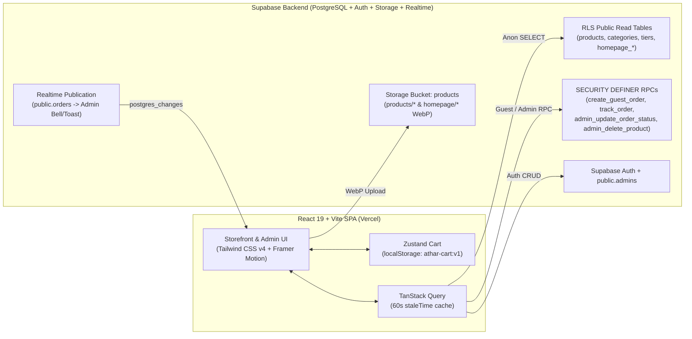
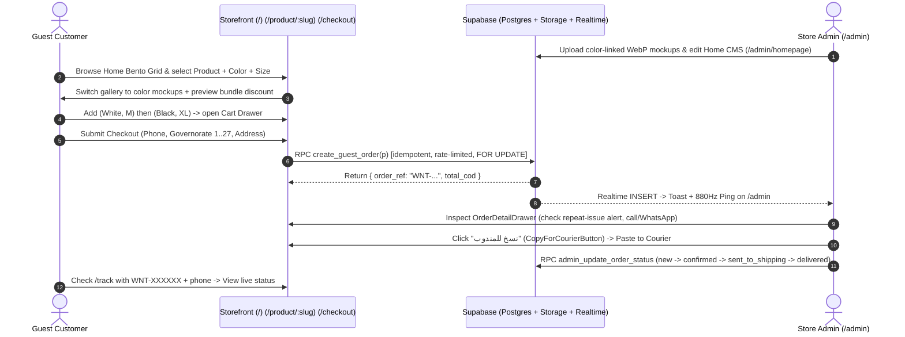

# أثر — Project Blueprint & Technical Architecture

> **Source of Truth Notice:** Every architecture diagram, database schema, symbol name, route, RLS policy, and discrepancy documented below was verified directly against the current repository codebase and `supabase/schema.sql`.

---

## 1. Executive Business Overview

**أثر** is an Egyptian direct-to-consumer (D2C) winter streetwear and apparel e-commerce storefront paired with a dedicated real-time Admin Dashboard and Home Page CMS.

| Dimension | Implementation Details |
| :--- | :--- |
| **Target Market** | Egypt — supports shipping to all **27 Egyptian governorates** (Cairo, Giza, Alexandria through North/South Sinai). |
| **Primary Product Focus** | Winter apparel mockups & essentials: Heavyweight Hoodies/Sweatshirts (`480gsm`), Knitwear, Puffers/Jackets, Wool Coats, and Winter Pants. |
| **Payment & Fulfillment Model** | **100% Cash on Delivery (COD)** — zero online payment gateway fees/friction. Admin operations use manual phone/WhatsApp confirmation and a **one-click "Copy for Courier" (`نسخ للمندوب`)** workflow formatted via a customizable template. |
| **Zero-Friction Guest Checkout** | No customer accounts or login required. Guests check out in one step using a normalized 11-digit Egyptian mobile number (`01[0125]XXXXXXXX`), guarded by client/server Zod + SQL regex checks, a honeypot field (`website`), per-phone rate limiting, and `idempotency_key` deduplication. |
| **Color-Linked Mockup Switching** | Product images are tied to `color_name` + `color_hex` in `product_images`. Selecting a color swatch on the Product Details page crossfades the gallery (`ProductGallery.tsx`), hovering a color dot on `ProductCard` previews that color's primary image, and adding to cart snapshots the color-matched image. |
| **Automatic Tiered Discounts** | Mix-and-match bundle pricing per product across any sizes/colors (`Buy 2+ Save 10%`, `Buy 3+ Save 15%`, or product-specific fixed/percentage overrides), mirrored 1:1 between the frontend TypeScript engine (`calculateCart.ts`) and PostgreSQL RPC (`create_guest_order` / `group_discount`). |
| **Bilingual Localization** | Full **Arabic (`ar`, default `dir="rtl"`)** and **English (`en`, `dir="ltr"`)** UI via `i18next`, RTL-mirrored drawers/carousels/marquees/arrows, and EGP currency formatting (`formatEGP`). |
| **Admin Self-Service CMS** | Dedicated `/admin/homepage` CMS allowing non-technical store owners to manage Hero slides, Marquee ticker items, Campaign Promo Banner (including overlay opacity), and Bento Grid Category Cards stored in Supabase. |

---

## 2. Codebase & Folder Structure Audit

The repository uses a **feature-sliced + shared domain** structure built on Vite + React 19 + TypeScript.

### 2.1 Root Files & Configurations
- `package.json`: React `19.1.0`, Vite `6`/`7` (`@tailwindcss/vite` v4.1.3), `@supabase/supabase-js`, `@tanstack/react-query`, `zustand`, `framer-motion`, `react-hook-form`, `zod`, `i18next`, `lucide-react`, `sonner`, `vitest`.
- `vite.config.ts`: `@/` path alias mapped to `./src`, React plugin, Tailwind CSS v4 Vite plugin.
- `vercel.json`: SPA fallback rewrite (`/(.*) -> /index.html`), immutable caching on `/assets/(.*)`, security headers (`X-Content-Type-Options: nosniff`, `X-Frame-Options: DENY`, `Referrer-Policy`).
- `.env.example`: Required `VITE_SUPABASE_URL`, `VITE_SUPABASE_ANON_KEY`; optional `VITE_SITE_NAME`, `VITE_SITE_URL`, `VITE_DEFAULT_LANG`, `VITE_WHATSAPP_NUMBER`, `VITE_META_PIXEL_ID`.
- `supabase/schema.sql`: Complete PostgreSQL schema, triggers, RPC functions (`create_guest_order`, `track_order`, `admin_update_order_status`, `admin_delete_product`), RLS policies, Storage bucket policies, and seed data.

### 2.2 `src/` Directory Map & Key Module Roles

```text
src/
├── app/
│   ├── providers.tsx              # QueryClientProvider, MotionConfig (reducedMotion="user"), Toaster
│   ├── ProtectedRoute.tsx         # Guards /admin/* via useAdminSession() + isSupabaseConfigured check
│   └── router.tsx                 # BrowserRouter: StoreLayout (eager) + lazy-loaded /admin/* routes
├── lib/
│   ├── supabase.ts                # Zod-validated Supabase client (falls back cleanly if env missing)
│   ├── queryClient.ts             # TanStack Query defaults (retry: 1, staleTime: 60s, no window refocus)
│   ├── format.ts                  # formatEGP, formatDate, slugify
│   ├── analytics.ts               # trackPixelEvent (Meta Pixel fbq wrapper, optional via VITE_META_PIXEL_ID)
│   └── i18n/
│       ├── index.ts               # i18next config + persisted language preference
│       ├── ar.json / en.json      # Complete Arabic & English UI translation dictionaries
├── shared/
│   ├── types/
│   │   ├── database.ts            # Typed Supabase Database schema (Tables, Views, Functions)
│   │   └── domain.ts              # App interfaces: ProductWithDetails, CartItem, OrderRecord, CMS types
│   ├── pricing/
│   │   ├── tiers.ts               # resolveTiers, bestTier, nextTier, describeTier
│   │   ├── calculateCart.ts       # Pure pricing engine matching SQL group_discount & create_guest_order
│   │   └── pricing.test.ts        # 11 unit tests for tier math, rounding allocation, free shipping
│   ├── validation/
│   │   ├── phone.ts               # normalizeEgPhone (+20/0020/Arabic-Indic numerals -> 01xxxxxxxxx)
│   │   ├── checkoutSchema.ts      # Zod form validation (name, phone, gov, city, address, honeypot)
│   │   ├── productSchema.ts       # Zod admin product form validation
│   │   └── validation.test.ts     # 4 unit tests for phone normalization & checkout schema
│   ├── constants/
│   │   ├── orderStatus.ts         # Status labels/colors + buildCourierMessage() template interpolator
│   │   └── transitions.ts         # ALLOWED_STATUS_TRANSITIONS state machine & TRACKING_STEPS
│   ├── hooks/                     # useDir (lang/isRtl), useDocumentTitle, useDebounce
│   └── components/
│       ├── ui/                    # Badge, Button, Dialog, Drawer, EmptyState, Input, PriceTag, QuantityStepper, Select, Skeleton
│       └── motion/                # PageTransition, StaggerGrid, AnimatedProductCard, AnimatedDiscountBadge, AnimatedCartDrawer
└── features/
    ├── storefront/
    │   ├── api/                   # useProducts, useProduct, useCategories, useTiers, usePublicSettings, useHomepageContent
    │   ├── layout/                # StoreLayout, Header (sticky + portal mobile drawer), Footer, LanguageToggle, WhatsAppButton
    │   ├── components/            # HeroSection, ProductCard, ProductGallery, VariantPicker, CategoryChips, TierOfferBanner
    │   └── pages/                 # HomePage, CatalogPage, ProductPage, TrackOrderPage, NotFoundPage
    ├── cart/
    │   ├── cartStore.ts           # Zustand store persisted to `athar-cart:v1` with buildCartItemKey + changeVariant
    │   ├── cartStore.test.ts      # 4 unit tests for multi-color/size identity, merging, and tier integration
    │   ├── useCartPricing.ts      # Combines cart items with live Supabase products/tiers/settings -> calculateCart
    │   ├── CartDrawer.tsx         # Slide-over cart drawer with live stock sync & next-tier upsell banner
    │   ├── CartPage.tsx           # Full /cart view
    │   ├── CartLine.tsx           # Line item with thumbnail, inline color/size selectors, QuantityStepper, savings badge
    │   └── PriceSummary.tsx       # Subtotal, discount savings, shipping, free-shipping progress, COD total
    ├── checkout/
    │   ├── api/                   # useShippingRates, useCreateOrder (RPC `create_guest_order`)
    │   ├── GovernorateSelect.tsx  # 27 governorates selector showing live fees
    │   ├── OrderSummary.tsx       # Read-only line + price summary
    │   ├── CheckoutPage.tsx       # Guest form (sessionStorage draft), honeypot, error handling, mobile sticky CTA
    │   └── OrderConfirmationPage.tsx # Order ref copy + WhatsApp quick-confirm link
    └── admin/
        ├── auth/                  # useAdminSession (checks auth session + admins table), AdminLoginPage
        ├── api/                   # useAdminOrders (+Realtime), useAdminProducts, useAdminTiers, useAdminShipping, useAdminSettings, useAdminHomepage
        ├── layout/                # AdminLayout, Sidebar, TopBar
        ├── components/            # ImageUploader (WebP + color grouping), VariantMatrixEditor, TierEditor, StatusBadge, CopyForCourierButton
        └── pages/                 # OverviewPage, OrdersPage, OrderDetailDrawer, ProductsPage, ProductFormPage, DiscountsPage, ShippingPage, HomepageCmsPage, SettingsPage
```

---

## 3. Technical Architecture & Data Layer (Supabase + Frontend)

### 3.1 System Architecture Diagram



### 3.2 Routing & State Management
- **Storefront Routes** (eagerly loaded under `StoreLayout`): `/`, `/shop`, `/product/:slug`, `/cart`, `/checkout`, `/order/:ref`, `/track`, `*`.
- **Admin Routes** (code-split via `React.lazy`, protected by `ProtectedRoute` except `/admin/login`): `/admin`, `/admin/orders`, `/admin/products`, `/admin/products/new`, `/admin/products/:id`, `/admin/homepage`, `/admin/discounts`, `/admin/shipping`, `/admin/settings`.
- **Cart State (`useCartStore`)**: Persisted in `localStorage` under `athar-cart:v1`; `sanitizeItems` validates and backfills `cartItemKey` on hydration. Checkout form drafts persist in `sessionStorage` (`athar-checkout-draft:v1`).
- **Admin Realtime**: `useAdminOrdersRealtime` subscribes to `postgres_changes` on `public.orders`, invalidates `['admin', 'orders']`, shows a Sonner toast on new `INSERT`s, and plays an 880Hz Web Audio ping.

### 3.3 Supabase Database Schema, Storage & RLS Summary

| Table | Public (`anon`) Access | Admin (`authenticated` + `is_admin()`) | Notes / Constraints |
| :--- | :--- | :--- | :--- |
| `admins` | Revoked | Full (`ALL`) | Maps `auth.users(id)` to admin privileges |
| `categories` | `SELECT` where `is_active` | Full (`ALL`) | Unique `slug`, ordered by `sort_order` |
| `products` | `SELECT` where `is_active and not is_archived` | Full (`ALL`) | Integer `base_price > 0` (whole EGP) |
| `product_images` | `SELECT` via active parent product | Full (`ALL`) | `color_name` & `color_hex` (`null` = all colors fallback) |
| `product_variants` | `SELECT` where `is_active` | Full (`ALL`) | Unique `(product_id, size, color_name)`, `stock >= 0` |
| `discount_tiers` | `SELECT` where `is_active` | Full (`ALL`) | `product_id = null` (global) or product override; `min_qty >= 2`; percent `<= 90` |
| `governorate_shipping` | `SELECT` where `is_active` | Full (`ALL`) | 27 pre-seeded Egyptian governorates (`id 1..27`) |
| `store_settings` | `SELECT` where `is_public` | Full (`ALL`) | Public: `free_shipping_threshold`, `whatsapp_number`; Private: `low_stock_threshold`, `courier_template` |
| `orders` / `order_items` / `order_status_history` | **Revoked** (`create_guest_order` & `track_order` RPCs only) | Full (`ALL`) | `phone` regex `^01[0125][0-9]{8}$`, unique `order_ref` (`WNT-XXXXXX`), unique `idempotency_key` |
| `homepage_hero` | `SELECT` where `is_active` | Full (`ALL`) | Multi-slide hero content, CTAs, floating spec tag, 3 trust stats |
| `homepage_marquee_items` | `SELECT` where `is_active` | Full (`ALL`) | Ordered bilingual ticker messages |
| `homepage_promo_banner` | `SELECT` where `is_active` | Full (`ALL`) | Banner copy, `overlay_opacity (0..1)`, `pill_tags_ar/en[]` |
| `homepage_category_cards` | `SELECT` where `is_active` | Full (`ALL`) | Visual Bento Grid tiles linked via `category_slug` |
| Storage `products` | Public read (`bucket_id = 'products'`) | `INSERT`/`UPDATE`/`DELETE` via inline `EXISTS (SELECT 1 FROM public.admins)` | Avoids `is_admin()` `SECURITY DEFINER` JWT context issue in Supabase Storage RLS |

### 3.4 Observed Code Gaps & Discrepancies
1. **RPC Sync Gap (`create_guest_order` image selection):** `supabase/schema.sql` (line 319) was updated to order `product_images` by `(pi.color_name = v.color_name) desc, is_primary desc, sort_order limit 1`, whereas the live Postgres function needs to be re-applied if not yet re-run since the initial migration.
2. **Client-Side Category Filter After Server `.limit()` (`useProducts.ts`):** `useProducts` passes `.limit(filters.limit)` (24 in `CatalogPage`) to Supabase before filtering `filters.categorySlug` in JavaScript (`rows.filter(...)`). If >24 active products exist, older items in a filtered category will be omitted from the first page.
3. **Empty Cart Query (`useCartPricing.ts`):** When `items` is empty, `ids: ['__none__']` is passed to `useProducts` instead of disabling the query (`enabled: productIds.length > 0`), sending an invalid UUID filter (`__none__`) against `products.id`.
4. **Bundle Chunking (`vite.config.ts`):** No `manualChunks` configuration is present; Vite emits a >500 kB chunk warning (`dist/assets/index-*.js` ~1.04 MB raw / ~313 kB gzip).
5. **Product Image Replacement Strategy (`ProductFormPage.tsx`):** Saving product edits deletes and re-inserts all rows in `product_images` (`delete().eq('product_id', productId)` followed by `insert(...)`) rather than diffing/upserting, which temporarily leaves zero images during a failed second step and regenerates `product_images.id` UUIDs on every save.
6. **Admin RLS Policy Scoping Consistency (`supabase/schema.sql`):** CMS tables (`homepage_*`) use `for select using (is_active or public.is_admin())` without explicit `to anon, authenticated` clauses, whereas core catalog tables specify roles explicitly. Functionally safe, but inconsistent.

---

## 4. Business Logic & Pricing Engine Breakdown

### 4.1 Tiered Quantity Discounts (`tiers.ts` & `calculateCart.ts` & SQL `group_discount`)
- **Scope Resolution (`resolveTiers`):** If a product has one or more active product-specific `discount_tiers` rows (`product_id === product.id`), those **completely replace** global rules (`product_id === null`) for that product. Otherwise, global tiers apply.
- **Cross-Variant Grouping:** Quantities are summed **per `productId` across all colors and sizes** in the cart (`groupLines`), enabling *"mix any color/size of the same product"*. Different products never combine.
- **Best Tier Only (No Stacking):** `bestTier(scopedTiers, totalQty)` selects the single highest tier where `minQty <= totalQty`.
- **Whole-EGP Math & Remainder Allocation:**
  - `percent`: `Math.round((groupOriginal * value) / 100)`.
  - `fixed`: `Math.min(value, groupOriginal)` (subtracted once from the product group, not per item).
  - Line discounts are allocated proportionally across sorted variants, with the **last line receiving `remaining`** (`groupDiscount - allocated`) so line discounts always sum identically to `groupDiscount` (mirrored 1:1 in `create_guest_order`).

### 4.2 Color & Size Variant Handling (`cartItemKey` & Color-Linked Images)
- **Line Identity (`buildCartItemKey`):** Key format is `${productId.trim()}::${normalize(colorName)}::${normalize(size)}` (lowercase, trimmed, collapsed whitespace).
  - Adding the same `(productId, color, size)` increments quantity up to `Math.min(10, variant.stock)`.
  - Adding the same `productId` with a different color or size appends a separate `CartItem` row so each combination is independently visible and editable.
  - Changing a line's color/size inside `CartDrawer` or `CartPage` (`changeVariant`) updates `cartItemKey`, `variantId`, and snapshot `imageUrl`, automatically **merging quantities** if the target `(color, size)` already exists in the cart.
- **Color-Linked Gallery Fallback Chain (`ProductGallery.tsx`):**
  1. Images matching `selectedColor` (case-insensitive, trimmed).
  2. Images with `color_name === null` (unassigned / universal mockups).
  3. Fallback to all `product_images` if neither yields results.

### 4.3 Shipping, Checkout Validation & Stock Deduction
1. **Free Shipping Threshold:** `isFreeShipping = shippingFee !== null && threshold > 0 && subtotalAfterDiscount >= threshold` (checked *after* bundle discounts, both in JS and SQL).
2. **Phone Normalization (`normalizeEgPhone` & SQL `normalize_eg_phone`):** Converts Arabic-Indic numerals (`٠-٩`) to ASCII, strips spaces/dashes/parentheses, and converts `+20`/`0020` prefixes to standard `01[0125]XXXXXXXX`.
3. **Atomic Order Creation (`create_guest_order`):**
   - Short-circuits idempotently if `idempotency_key` already exists (`duplicate: true`).
   - Validates fields and checks rate limit (`< 3` orders from that normalized phone in the last 1 hour).
   - Locks requested `product_variants` rows (`FOR UPDATE`) in deterministic `id` order to avoid deadlocks; raises `STOCK_UNAVAILABLE` with JSON `available` counts if any variant is inactive/archived/insufficient (client catches and triggers `syncStock`).
   - Generates unique `WNT-XXXXXX` reference, inserts `orders`, `order_items`, `order_status_history`, and atomically decrements `product_variants.stock`.

---

## 5. Complete User Stories (Guest Customer & Admin)

### 5.1 Guest Customer User Stories

1. **Editorial Discovery & Bilingual Browsing**
   - *As a guest shopper*, I want to land on a fast, bilingual (`AR` RTL / `EN` LTR) homepage with curated visual categories and live promos, so I can immediately find seasonal winter items in my preferred language.
   - *Acceptance Criteria:* Hero, Marquee, Category Bento Grid, Promo Banner, and Featured Grid adapt text & direction when toggling `AR`/`EN`; zero horizontal overflow across `375px`–`1440px`.
2. **Category & Price Filtering**
   - *As a guest shopper*, I want to filter the catalog by category chip and sort by newest or price (`price_asc` / `price_desc`), so I can quickly locate items within my budget.
   - *Acceptance Criteria:* Category selection syncs with `/shop?category=<slug>`; pagination loads more items; out-of-stock products show a Sold Out overlay.
3. **Color-Linked Gallery & Variant Selection**
   - *As a guest shopper*, I want clicking a color swatch on a product page (or hovering dots on product cards) to show that color's exact mockup images and valid sizes, so I buy with visual confidence.
   - *Acceptance Criteria:* `ProductGallery` crossfades to color-specific images (falling back gracefully to general images); switching to a color where the prior size is out of stock clears the stale size selection.
4. **Mix-and-Match Multi-Variant Bundle Adding**
   - *As a guest shopper*, I want to add `(White, M)` and then `(Black, XL)` of the same hoodie and see both lines separately while getting the combined quantity discount, so I can buy multiple styles in one bundle.
   - *Acceptance Criteria:* Each distinct `(productId, color, size)` renders as its own `CartLine`; `ProductPage` resets quantity to `1` and clears size after adding; `PriceSummary` applies the combined `productId` tier across both lines.
5. **In-Cart Editing & Stock Protection**
   - *As a guest shopper*, I want to adjust quantities, switch color/size directly inside the Cart Drawer/Page, or remove items, so I don't have to return to product pages to fix my order.
   - *Acceptance Criteria:* `CartLine` allows inline color/size dropdown changes (merging duplicates cleanly); quantities cannot exceed available variant stock or `10`; stale/sold-out variants are flagged.
6. **Zero-Login COD Checkout & Order Tracking**
   - *As a guest shopper*, I want to select my Egyptian governorate to see the exact shipping fee, confirm my COD order without registering, and track my `WNT-XXXXXX` order using my phone number.
   - *Acceptance Criteria:* Invalid/non-Egyptian numbers show localized validation errors; duplicate clicks use the same `idempotency_key`; `/order/:ref` provides one-click ref copy and WhatsApp confirmation; `/track` shows the 4-step status progress bar via `track_order` RPC.

### 5.2 Admin User Stories

1. **Authenticated Admin Access**
   - *As an admin*, I want `/admin/*` routes protected by Supabase Auth + `admins` membership checks, so unauthorized users cannot access store operations or customer PII.
   - *Acceptance Criteria:* Unauthenticated visitors redirect to `/admin/login`; `ProtectedRoute` verifies both active session and row presence in `public.admins`.
2. **Product & Color-Linked Mockup Management**
   - *As an admin*, I want to create/edit products, define `(size, color, hex, stock, SKU)` matrices, and upload WebP images tagged to specific colors, so customers only see accurate mockups and live stock.
   - *Acceptance Criteria:* `ImageUploader` converts uploads to WebP (`<= 1600px`), groups previews by color, supports setting primary image & reordering, and persists `color_name`/`color_hex` to `product_images`.
3. **Home Page CMS Control (`/admin/homepage`)**
   - *As an admin*, I want to edit Hero slides, Marquee items, Promo Banner copy/image/opacity, and Category Bento Grid cards directly in the dashboard, so storefront campaigns update live without code deployments.
   - *Acceptance Criteria:* Every save/reorder/toggle invalidates `['homepage']` and `['admin', 'homepage']`; image uploads optimize to WebP under `products/homepage/*`.
4. **Tiered Discount & 27-Governorate Shipping Control**
   - *As an admin*, I want to configure global/per-product bundle tiers (with a live price simulator) and bulk-edit shipping fees + free-shipping thresholds across all 27 governorates, so pricing margins stay profitable.
   - *Acceptance Criteria:* Duplicate `min_qty` tiers are blocked; bulk fee and threshold changes persist atomically.
5. **Real-Time Order Fulfillment & Courier Handoff**
   - *As an admin*, I want to receive live audio/toast alerts for new orders, check repeat-return/cancel warnings by phone, advance order statuses (with optional automatic restocking), export CSVs, and copy formatted shipping details in one click.
   - *Acceptance Criteria:* `ALLOWED_STATUS_TRANSITIONS` enforces valid workflow transitions; cancelling/returning restores stock once (`stock_restocked`); `CopyForCourierButton` formats `courier_template` cleanly.

---

## 6. End-to-End Operational Workflows



---

## 7. Actionable Improvement Proposals (Prioritized)

### Priority 1: Quick Wins / High Impact
1. **Sync Live `create_guest_order` RPC in Supabase:** Apply the updated color-matched `image_url` subquery in `supabase/schema.sql` (line 319) to the live Postgres instance so `order_items.image_url` stored in orders/admin always matches the purchased variant color.
2. **Fix Server-Side Category Filtering in `useProducts.ts`:** Replace `.select('*, category:categories(*) ...')` client-side `.filter()` with an inner-join filter (`.select('..., category:categories!inner(*)')` + `.eq('category.slug', filters.categorySlug)`) before applying `.limit()`, preventing missing catalog items once products exceed 24.
3. **Disable Empty-Cart Fetch in `useCartPricing.ts`:** Pass `enabled: productIds.length > 0` (via `ProductFilters` option) instead of `ids: ['__none__']` to eliminate invalid-UUID network requests when the cart is empty.
4. **Configure Vite Code-Splitting (`vite.config.ts`):** Add `build.rollupOptions.output.manualChunks` for `framer-motion`, `@supabase/supabase-js`, and `@tanstack/react-query` to drop the main bundle well under Vite's 500 kB threshold and speed up mobile first load.

### Priority 2: UX & Conversion
5. **Persistent Storefront Toast / Inline Variant Confirmation:** Add a subtle inline *"Added 1× White / M to cart — pick another color/size"* prompt on `ProductPage` when `qty` resets after adding, making multi-variant bundle building obvious to first-time mobile shoppers.
6. **Cart Drawer Live Variant Stock Feedback:** In `CartLine.tsx`, show an explicit badge when stock is low (`<= low_stock_threshold`) or when switching variants merges two lines together (`toast.info(...)`).
7. **Live Preview in `/admin/homepage`:** Add an inline mobile/desktop mini-preview pane for the Hero & Category Bento tabs (similar to the Promo Banner opacity preview) so the admin can verify AR/EN headline wrapping before publishing.
8. **Automated E2E Test Suite (Playwright):** Add headless Playwright tests covering multi-color cart addition, bundle tier calculation, guest checkout submission, and `/admin/homepage` CMS persistence across `375px`, `768px`, and `1440px`.

### Priority 3: Data Integrity, Security & Scale
9. **Non-Destructive `product_images` Save in `ProductFormPage.tsx`:** Replace `delete()`-then-`insert()` on product save with a single transactional RPC or diffed upsert/delete to prevent image loss if an insert fails mid-request, and preserve `product_images.id` stability.
10. **Clean Up Orphaned Supabase Storage Objects:** Delete removed files from Supabase Storage (`supabase.storage.from('products').remove(...)`) when an admin deletes an image in `ImageUploader` or replaces a Hero/Banner/Category cover in `HomepageCmsPage` to avoid unbounded storage bloat.
11. **Database-Level Audit & Pagination on Admin Orders:** `useAdminOrders('all')` currently fetches every order + items + history unpaginated. Add server-side pagination/date-window filtering (`range(from, to)` + search RPC/ilike) before order volume exceeds a few thousand rows.
12. **Standardize Explicit RLS Roles on `homepage_*` Tables:** Explicitly scope `homepage_*` policies with `to anon, authenticated` (`SELECT`) and `to authenticated` (`ALL`) to match the rest of `supabase/schema.sql`.
